# 🍔 TastyGo — Food Delivery Microservices Application

TastyGo is a food delivery application developed using a microservices architecture. The project demonstrates application containerization, backend service separation, database integration, and deployment using Docker and Kubernetes.

The project is part of my hands-on learning journey in DevOps and cloud technologies.

## 🚀 Project Overview

TastyGo is designed to demonstrate how a food delivery application can be divided into independent services that communicate through APIs.

### Key Features

- React-based frontend
- Node.js and Express.js backend services
- API Gateway
- User Service
- Product Service
- Order Service
- MySQL database integration
- Docker containerization
- Docker Compose for local development
- Kubernetes deployment manifests
- KIND for local Kubernetes testing
- Helm chart for Kubernetes resource management
- AWS deployment practice using EKS and ECR

## 🛠️ Technology Stack

| Category | Technologies |
|---|---|
| Frontend | React.js |
| Backend | Node.js, Express.js |
| Database | MySQL |
| Containerization | Docker, Docker Compose |
| Orchestration | Kubernetes, KIND |
| Package Management | Helm |
| Cloud Platform | AWS |
| Container Registry | Amazon ECR |
| Version Control | Git, GitHub |
| Operating System | Linux |

## 🏗️ Application Architecture

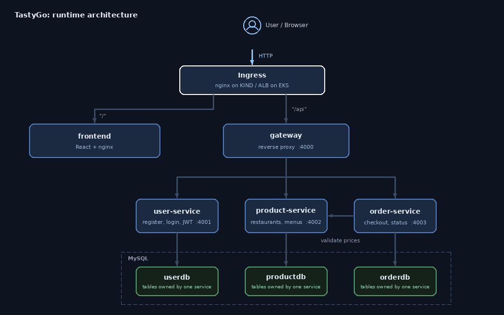

## 📂 Project Structure

```text
Zomato-Clone-Microservices/
│
├── frontend/
├── services/
│   ├── gateway/
│   ├── user-service/
│   ├── product-service/
│   └── order-service/
│
├── db/
│   └── init.sql
│
├── docker-compose.yaml
├── kind-cluster.yaml
│
├── k8s/
│   ├── configmap.yaml
│   ├── deployment.yaml
│   ├── hpa.yaml
│   ├── ingress.yaml
│   ├── mysql-grants-config.yaml
│   ├── mysql-init-config.yaml
│   ├── namespace.yaml
│   ├── rbac.yaml
│   ├── secrets.yaml
│   ├── service.yaml
│   ├── statefulset.yaml
│   └── storageclass.yaml
├── helm/
│   └── tastygo/
│
├── images/
│   └── architecture.gif
│
└── README.md
```

## ⚙️ Getting Started

### Prerequisites

Install the tools needed for the workflow you want to run:

- Git
- Docker
- Docker Compose
- Node.js and npm, if running services directly
- KIND
- kubectl
- Helm

AWS CLI is needed only for AWS-related tasks.

### 1. Clone the Repository

```bash
git clone https://github.com/Shubh1220/Zomato-Clone-Microservices.git
cd Zomato-Clone-Microservices
```

### 2. Run with Docker Compose

Review the Compose file and configure the required environment variables before starting the application.

```bash
docker compose up -d --build
```

Check the containers:

```bash
docker compose ps
```

View application logs:

```bash
docker compose logs -f
```

Stop the application:

```bash
docker compose down
```

## ☸️ Kubernetes Deployment with KIND

Create the local cluster using your KIND configuration, if available:

```bash
kind create cluster --config kind-cluster.yaml
```

Check the cluster:

```bash
kubectl cluster-info
kubectl get nodes
```

Apply the Kubernetes manifests after reviewing the namespace and resource configuration:

```bash
kubectl apply -f k8s/
```

Verify deployed resources:

```bash
kubectl get pods -A
kubectl get services -A
kubectl get deployments -A
```

## 📦 Helm

The Helm chart can be used to package and manage Kubernetes resources.

Validate the chart:

```bash
helm lint ./helm/tastygo
```

Preview the generated manifests:

```bash
helm template tastygo ./helm/tastygo
```

Install or upgrade the release:

```bash
helm upgrade --install tastygo ./helm/tastygo
```

These commands require a valid chart and a working Kubernetes context.

## ☁️ AWS ECR and EKS Deployment

This section documents how to push TastyGo Docker images to Amazon Elastic Container Registry (ECR) and deploy the application to Amazon Elastic Kubernetes Service (EKS).

**Prerequisites**

- AWS CLI configured with an IAM identity that has the required permissions
- Docker installed and running
- `kubectl` installed
- `eksctl` installed
- A valid Kubernetes configuration in the `k8s/` directory

### 1. Configure AWS CLI

Check the installed AWS CLI version:

```bash
aws --version
```

Configure credentials if required:

```bash
aws configure
```

Verify the AWS identity:

```bash
aws sts get-caller-identity
```

Set the deployment region:

```bash
export AWS_REGION=us-east-1
export CLUSTER_NAME=tastygo-eks
export AWS_ACCOUNT_ID=$(aws sts get-caller-identity --query Account --output text)
```

These examples use `us-east-1`, the region used for the previous TastyGo deployment.

### 2. Create Amazon ECR Repositories

Create one private ECR repository for each application image:

```bash
aws ecr create-repository --repository-name tastygo-frontend --region $AWS_REGION
aws ecr create-repository --repository-name tastygo-gateway --region $AWS_REGION
aws ecr create-repository --repository-name tastygo-user-service --region $AWS_REGION
aws ecr create-repository --repository-name tastygo-product-service --region $AWS_REGION
aws ecr create-repository --repository-name tastygo-order-service --region $AWS_REGION
```

List the repositories:

```bash
aws ecr describe-repositories --region $AWS_REGION
```

### 3. Log In to Amazon ECR

Authenticate Docker to the ECR registry:

```bash
aws ecr get-login-password --region $AWS_REGION \
  | docker login \
    --username AWS \
    --password-stdin $AWS_ACCOUNT_ID.dkr.ecr.$AWS_REGION.amazonaws.com
```

### 4. Build, Tag, and Push Docker Images

Run these commands from the repository root. Adjust each build path if your Dockerfiles are stored elsewhere.

**Frontend**

```bash
docker build -t tastygo-frontend ./frontend

docker tag tastygo-frontend:latest \
  $AWS_ACCOUNT_ID.dkr.ecr.$AWS_REGION.amazonaws.com/tastygo-frontend:latest

docker push \
  $AWS_ACCOUNT_ID.dkr.ecr.$AWS_REGION.amazonaws.com/tastygo-frontend:latest
```

**API Gateway**

```bash
docker build -t tastygo-gateway ./services/gateway

docker tag tastygo-gateway:latest \
  $AWS_ACCOUNT_ID.dkr.ecr.$AWS_REGION.amazonaws.com/tastygo-gateway:latest

docker push \
  $AWS_ACCOUNT_ID.dkr.ecr.$AWS_REGION.amazonaws.com/tastygo-gateway:latest
```

**User Service**

```bash
docker build -t tastygo-user-service ./services/user-service

docker tag tastygo-user-service:latest \
  $AWS_ACCOUNT_ID.dkr.ecr.$AWS_REGION.amazonaws.com/tastygo-user-service:latest

docker push \
  $AWS_ACCOUNT_ID.dkr.ecr.$AWS_REGION.amazonaws.com/tastygo-user-service:latest
```

**Product Service**

```bash
docker build -t tastygo-product-service ./services/product-service

docker tag tastygo-product-service:latest \
  $AWS_ACCOUNT_ID.dkr.ecr.$AWS_REGION.amazonaws.com/tastygo-product-service:latest

docker push \
  $AWS_ACCOUNT_ID.dkr.ecr.$AWS_REGION.amazonaws.com/tastygo-product-service:latest
```

**Order Service**

```bash
docker build -t tastygo-order-service ./services/order-service

docker tag tastygo-order-service:latest \
  $AWS_ACCOUNT_ID.dkr.ecr.$AWS_REGION.amazonaws.com/tastygo-order-service:latest

docker push \
  $AWS_ACCOUNT_ID.dkr.ecr.$AWS_REGION.amazonaws.com/tastygo-order-service:latest
```

Verify that images have been uploaded:

```bash
aws ecr list-images \
  --repository-name tastygo-frontend \
  --region $AWS_REGION
```

Repeat for the other repositories.

### 5. Create an Amazon EKS Cluster

> **Cost warning:** Creating an EKS cluster and worker nodes can incur charges. Check current AWS pricing before proceeding.

Create the cluster and a managed node group:

```bash
eksctl create cluster \
  --name $CLUSTER_NAME \
  --region $AWS_REGION \
  --nodes 2 \
  --node-type t3.medium
```

This command provisions AWS infrastructure and may take several minutes. Confirm that the selected instance type and configuration are suitable and available in your region.

### 6. Connect kubectl to EKS

Update the local Kubernetes configuration:

```bash
aws eks update-kubeconfig \
  --region $AWS_REGION \
  --name $CLUSTER_NAME
```

Verify the cluster and worker nodes:

```bash
kubectl get nodes
kubectl get namespaces
```

### 7. Update Kubernetes Image References

Before deploying, update the container image fields in your Kubernetes manifests to use the ECR image URIs.

Example:

```yaml
image: ACCOUNT_ID.dkr.ecr.us-east-1.amazonaws.com/tastygo-frontend:latest
```

Replace `ACCOUNT_ID` with your AWS account ID. Use the matching repository and image tag for each service.

Ensure the EKS worker nodes or configured workload identity have the permissions required to pull images from the ECR repositories. Also verify environment variables, database connectivity, Secrets, ConfigMaps, Services, and Ingress configuration.

### 8. Deploy the Application to EKS

Review the manifests before applying them. If the namespace manifest creates a dedicated namespace, create that namespace first:

```bash
kubectl apply -f k8s/namespace.yaml
```

Then apply the remaining manifests, adjusting the paths to match your repository:

```bash
kubectl apply -f k8s/
```

Check the deployment:

```bash
kubectl get pods -A
kubectl get deployments -A
kubectl get services -A
kubectl get ingress -A
```

Inspect application logs if a workload fails:

```bash
kubectl logs <pod-name> -n <namespace>
kubectl describe pod <pod-name> -n <namespace>
```

### 9. Verify EKS and ECR

Check the EKS cluster:

```bash
aws eks describe-cluster \
  --name $CLUSTER_NAME \
  --region $AWS_REGION \
  --query 'cluster.status'
```

List ECR repositories:

```bash
aws ecr describe-repositories \
  --region $AWS_REGION \
  --query 'repositories[].repositoryName'
```

Check application pods:

```bash
kubectl get pods -A
```

A successful command alone does not prove that the entire application works. Test the frontend and API endpoints and verify database operations.

### 10. AWS Cleanup

When you finish practising, delete the EKS cluster created with `eksctl`:

```bash
eksctl delete cluster \
  --name $CLUSTER_NAME \
  --region $AWS_REGION
```

Verify that the cluster no longer appears:

```bash
aws eks list-clusters --region $AWS_REGION
```

If you also want to delete the ECR repositories and their images, run:

```bash
aws ecr delete-repository \
  --repository-name tastygo-frontend \
  --region $AWS_REGION \
  --force

aws ecr delete-repository \
  --repository-name tastygo-gateway \
  --region $AWS_REGION \
  --force

aws ecr delete-repository \
  --repository-name tastygo-user-service \
  --region $AWS_REGION \
  --force

aws ecr delete-repository \
  --repository-name tastygo-product-service \
  --region $AWS_REGION \
  --force

aws ecr delete-repository \
  --repository-name tastygo-order-service \
  --region $AWS_REGION \
  --force
```

Check the AWS Console for any remaining billable resources, including load balancers, EBS volumes, snapshots, Elastic IP addresses, and NAT gateways. Do not delete shared networking or IAM resources without confirming they are no longer needed.

**Current status:** The previous TastyGo EKS cluster, ECR repositories, associated leftover EBS volume, load balancer(s), and EC2 instance were reported deleted. The commands above describe how to provision a new deployment; they do not indicate that these resources currently exist.

Before deploying again, review the required resources, IAM permissions, network configuration, and potential AWS costs.

## 🔐 Security Best Practices

- Do not commit passwords, API keys, or credentials.
- Use environment variables for application configuration.
- Restrict access to databases and internal services.
- Use appropriate IAM permissions and security groups.
- Review container images and dependencies.
- Configure Kubernetes resource limits and health checks where appropriate.
- Check AWS resources after completing a deployment to avoid unexpected charges.

## 🧪 Troubleshooting

### Docker

```bash
docker ps
docker compose ps
docker compose logs -f
```

### Kubernetes

```bash
kubectl get pods -A
kubectl get events -A
kubectl get services -A
```

For a specific pod:

```bash
kubectl describe pod <pod-name> -n <namespace>
kubectl logs <pod-name> -n <namespace>
```

## 📚 Learning Outcomes

Through this project, I practised:

- Microservices application architecture
- REST API-based service communication
- Docker and Docker Compose
- Kubernetes deployments and services
- Local Kubernetes testing with KIND
- Helm chart management
- AWS container deployment concepts
- Git and GitHub version control
- Cloud resource cleanup and cost awareness

## Screenshots

From a real EKS deployment of this architecture. The names in these screenshots come from that run
(cluster `tastygo-eks`, namespace `my-zomato-app`, a UI branded *TastyGo*, images in Amazon ECR Public);
the manifests in this repo use `tastygo` names, but the layout is the same.

**AWS infrastructure**

| EC2 build host | EKS cluster |
|---|---|
| 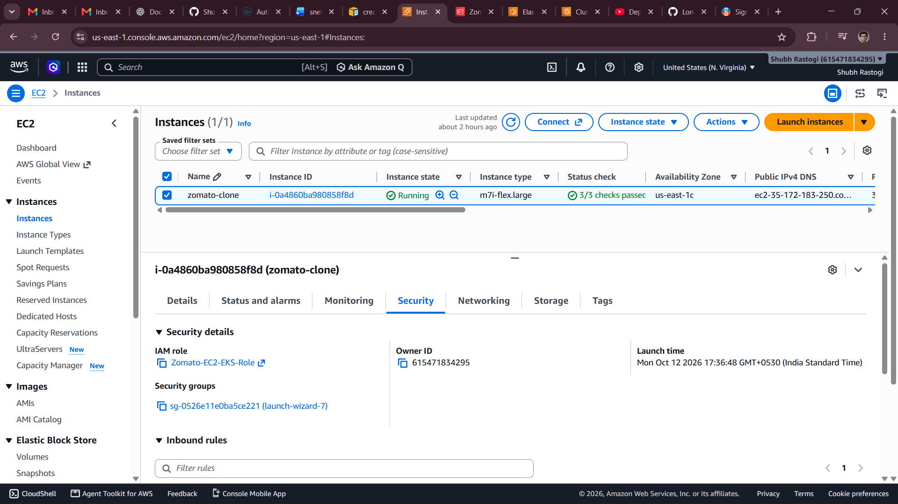 | 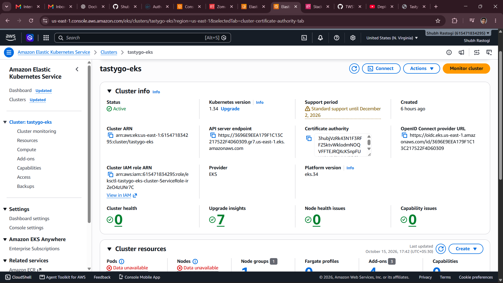 |
| The `zomato-clone` instance (running, 3/3 status checks) with its IAM role for EKS access. | `tastygo-eks`: Active, Kubernetes 1.34. |

| CloudFormation stack | Amazon ECR |
|---|---|
| 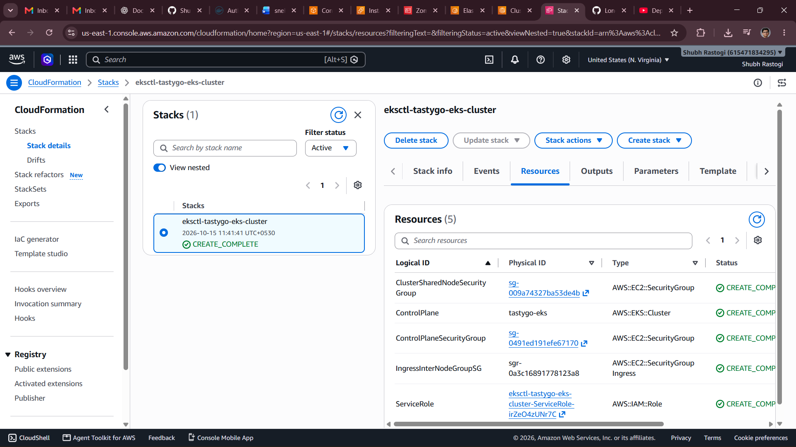 | 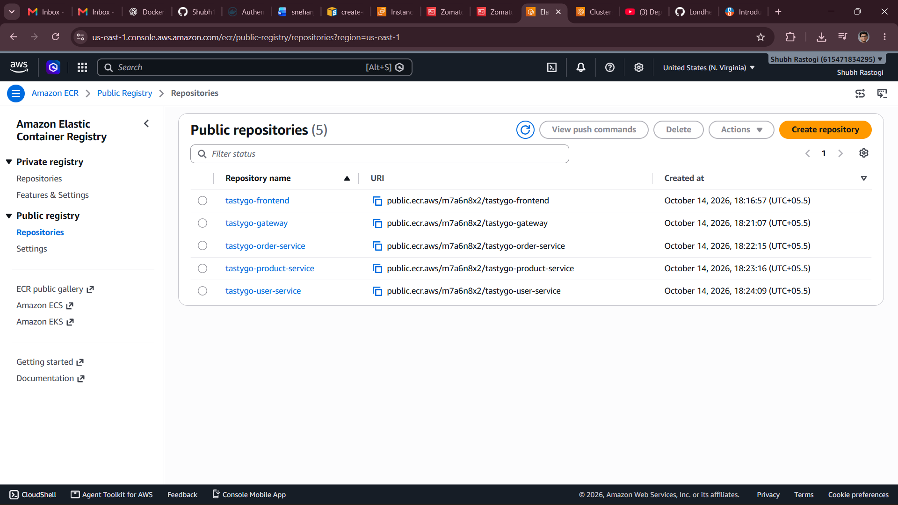 |
| `eksctl` created the cluster through a stack in `CREATE_COMPLETE`. | One repository per service: frontend, gateway, order, product, user. |

**Images and cluster**

| Docker images built on the build host | Worker nodes |
|---|---|
| 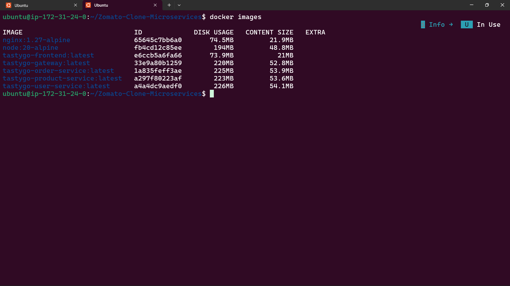 | 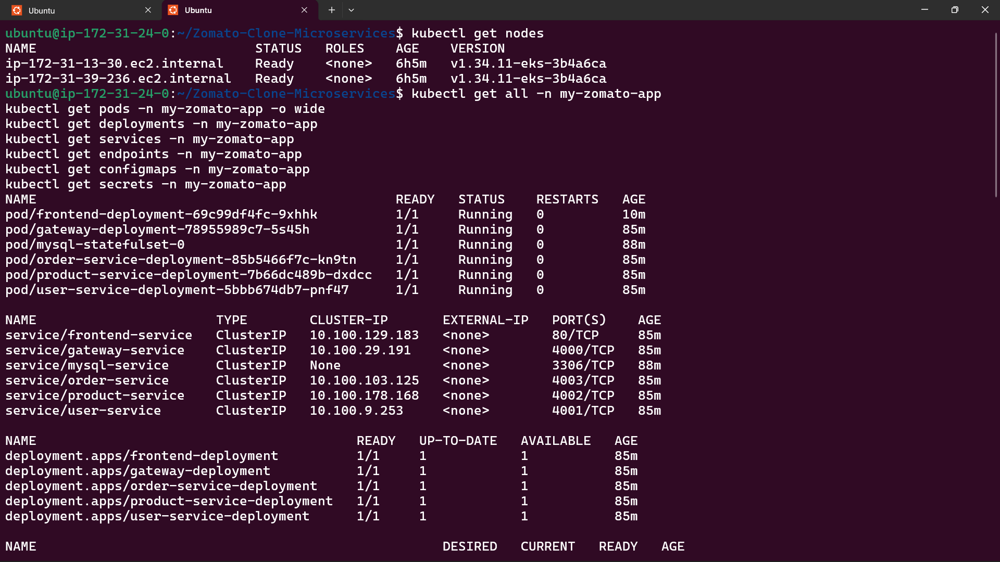 |
| Five service images plus the `node:20-alpine` and `nginx:1.27-alpine` bases. | Two nodes `Ready` on `v1.34.11-eks`, followed by `kubectl get all` for the namespace. |

**Workloads**

| Deployments, StatefulSet and pods | Services, ConfigMaps and Secret |
|---|---|
| 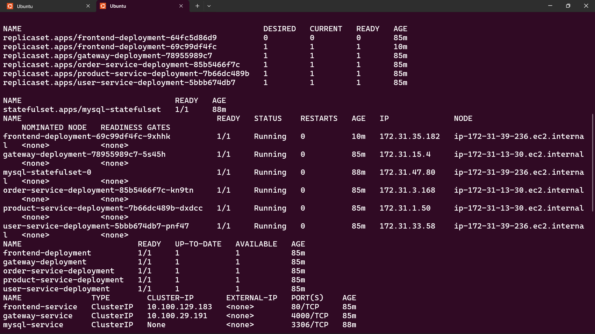 | 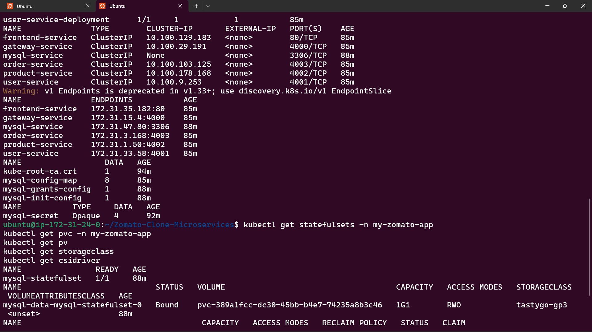 |
| All Deployments `1/1`, `mysql-statefulset` `1/1`, every pod `Running` across both nodes. | ClusterIP Services with their endpoints, the MySQL ConfigMaps and the `mysql-secret`. |

**Persistent storage and the running app**

| MySQL storage | App in the browser |
|---|---|
| 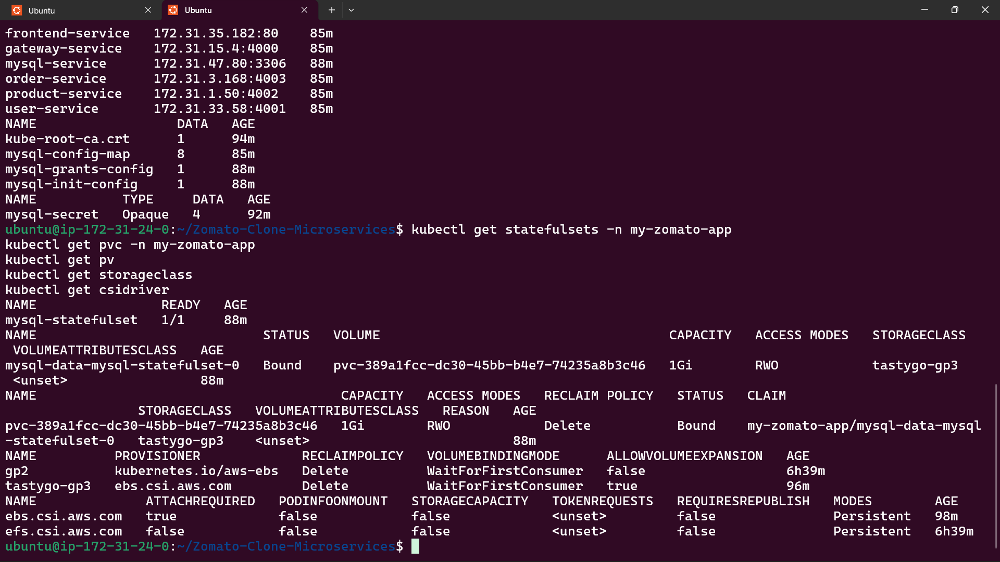 | 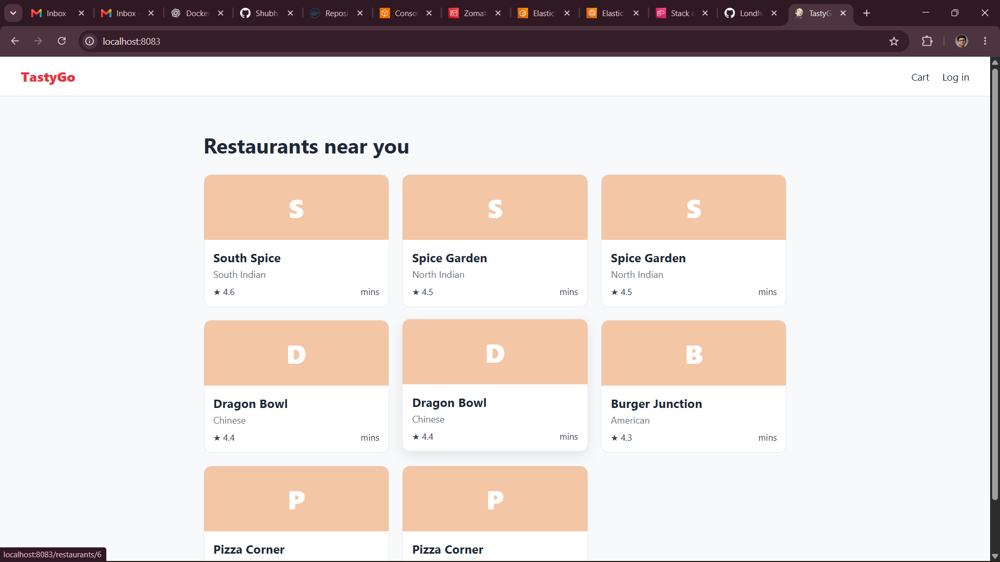 |
| The MySQL PVC is `Bound` to an EBS volume (`gp3` StorageClass, EBS CSI driver), with its PV. | The restaurant list served from the cluster. |

## 🔮 Future Improvements

- Add automated unit and integration tests.
- Improve monitoring and centralized logging.
- Add container image vulnerability scanning.
- Improve application health checks.
- Implement automated CI/CD.
- Explore Terraform for infrastructure as code.

## 👨‍💻 Author

**Shubh Rastogi**

- GitHub: https://github.com/Shubh1220
- LinkedIn: https://www.linkedin.com/in/shubh-rastogi-6a32273a1/

## 📄 License

A license can be added if the project is intended for distribution under a specific open-source license.

---

