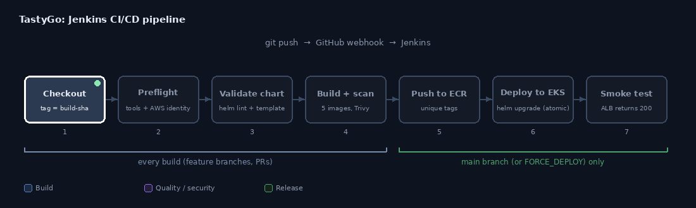

# TastyGo: Food-Delivery Microservices on Kubernetes

A food-delivery platform built as separate services and taken through the full DevOps path: a
working application, Kubernetes manifests, a Helm chart, Terraform for AWS (EKS + ECR), and a
Jenkins CI/CD pipeline that builds, scans, pushes and deploys it.

```
Restaurants → Menu → Cart → Login → Checkout → Place Order → Order Status → My Orders
```

> **Naming:** "TastyGo" is an original name. The app is modelled on the general shape of
> food-delivery apps, not on any company's branding. Restaurants, menu items and prices are
> fictional seed data (`db/init.sql`).

## Contents

- [What's in the project](#whats-in-the-project)
- [Architecture](#architecture)
- [Tech stack](#tech-stack)
- [Repository layout](#repository-layout)
- [Prerequisites](#prerequisites)
- [Phase 1: Application](#phase-1-application)
- [Phase 2: Kubernetes manifests](#phase-2-kubernetes-manifests)
- [Phase 3: Helm chart](#phase-3-helm-chart)
- [Phase 4: Terraform (EKS + ECR)](#phase-4-terraform-eks--ecr)
- [Phase 5: Jenkins CI/CD](#phase-5-jenkins-cicd)
- [From zero to deployed: suggested order](#from-zero-to-deployed-suggested-order)
- [Configuration reference](#configuration-reference)
- [Security notes](#security-notes)
- [Troubleshooting](#troubleshooting)
- [Verification status](#verification-status)
- [Known limitations](#known-limitations)
- [Cleaning up](#cleaning-up)

## What's in the project

| Phase | What you get | Where |
|---|---|---|
| 1. Application | 4 Node.js microservices + React frontend + MySQL, run with Docker Compose | `services/`, `frontend/`, `db/`, `docker-compose.yml` |
| 2. Kubernetes | Plain manifests: Namespace, Deployments, Services, ConfigMaps, Secret, Ingress, PV/PVC, StatefulSet, HPAs, probes, resource limits, RBAC | `k8s/` |
| 3. Helm | One chart packaging all of the above, with KIND and EKS value overlays | `helm/tastygo/` |
| 4. Terraform | VPC, EKS cluster, ECR repositories, IAM roles for the cluster add-ons and for Jenkins | `terraform/` |
| 5. Jenkins | A `Jenkinsfile`: validate chart, build and Trivy-scan images, push to ECR, `helm upgrade --atomic` to EKS, smoke test | `Jenkinsfile`, `jenkins/` |

Each phase builds on the previous one, and each folder has its own README with more detail.

## Architecture

### Runtime


- The frontend only ever calls `/api` on its own origin. With Docker Compose the frontend's nginx
  forwards `/api` to the gateway; on Kubernetes the Ingress routes `/api` to the gateway directly.
- **Each service owns its own database** (`userdb`, `productdb`, `orderdb`) on one MySQL server.
  No service reads another service's tables.
- `order-service` calls `product-service` over HTTP at checkout to fetch real prices, so the
  total is computed server-side and a client cannot tamper with it.
- Authentication is stateless: `user-service` issues a JWT, and `order-service` verifies it with
  the same `JWT_SECRET`.

### Delivery pipeline



### AWS footprint (Phase 4)

| Resource | Purpose |
|---|---|
| VPC, 2 public + 2 private subnets, NAT gateway | Network; nodes run in private subnets |
| EKS cluster + managed node group (2 to 4 `t3.medium`) | Runs the workloads |
| EKS add-ons: coredns, kube-proxy, vpc-cni, metrics-server, EBS CSI driver | Cluster basics; metrics-server feeds the HPAs, EBS CSI provides the MySQL volume |
| ECR: `tastygo/gateway`, `user-service`, `product-service`, `order-service`, `frontend` | Image registry (scan on push, lifecycle policy) |
| IAM roles (IRSA) for the EBS CSI driver and the AWS Load Balancer Controller | Least-privilege access for in-cluster controllers |
| Optional IAM role + instance profile for Jenkins | ECR push and cluster access without stored AWS keys |

## Tech stack

| Area | Technology |
|---|---|
| Frontend | React 18, Vite, React Router, served by nginx |
| Backend | Node.js 20, Express, `mysql2`, JWT (`jsonwebtoken`), `bcryptjs` |
| Gateway | Express + `http-proxy-middleware` |
| Database | MySQL 8 (StatefulSet on Kubernetes) |
| Containers | Docker, Docker Compose (multi-stage frontend build, non-root service images, health checks) |
| Orchestration | Kubernetes (KIND locally, Amazon EKS in AWS), ingress-nginx / AWS Load Balancer Controller |
| Packaging | Helm 3 |
| Infrastructure as code | Terraform (OpenTofu also works), `terraform-aws-modules` for VPC/EKS/IAM |
| Registry | Amazon ECR |
| CI/CD | Jenkins (declarative pipeline), GitHub webhook, Trivy image scanning |
| Version control | Git + GitHub |

## Repository layout

```
zomato-clone-microservices/
├── db
│   └── init.sql
├── services
│   ├── gateway
│   │   ├── Dockerfile
│   │   └── ... application files
│   ├── order-service
│   │   ├── Dockerfile
│   │   └── ... application files
│   ├── product-service
│   │   ├── Dockerfile
│   │   └── ... application files
│   └── user-service
│       ├── Dockerfile
│       └── ... application files
├── frontend/
│   ├── Dockerfile
│   └── ... application files
├── docker-compose.yaml
├──k8s
│   ├── configmap.yaml
│   ├── deployment.yaml
│   ├── hpa.yaml
│   ├── ingress.yaml
│   ├── mysql-grants-config.yaml
│   ├── mysql-init-config.yaml
│   ├── namespace.yaml
│   ├── rbac.yaml
│   ├── secrets.yaml
│   ├── service.yaml
│   └── statefulset.yaml
├── kind-cluster.yaml
├── helm/
│   └── tastygo/
│       ├── Chart.yaml
│       ├── values.yaml
│       └── templates/
├── terraform/
│   ├── versions.tf
│   ├── variables.tf
│   ├── vpc.tf
│   ├── iam.tf
│   ├── ecr.tf
│   ├── eks.tf
│   ├── outputs.tf
├── images
│   ├── architecture.gif
│   └── pipeline.gif
├── Jenkinsfile
├── .gitignore
└── README.md
```

## Prerequisites

| Tool | Needed for |
|---|---|
| Docker | every phase (building images, Compose, KIND) |
| Node.js 20+ | running services or the frontend without Docker |
| `kind`, `kubectl`, `helm` | Phases 2 and 3 |
| Terraform >= 1.5 (or OpenTofu), AWS CLI v2, AWS account | Phase 4 |
| A Jenkins host (EC2 suggested) with docker, aws, kubectl, helm, trivy | Phase 5 |

## Phase 1: Application

### Run with Docker Compose

```bash
docker compose up -d --build
docker compose ps             # wait until services show (healthy)
```

Open **http://localhost:8080**. Register an account, pick a restaurant, add items, check out, and
watch the order status page update on its own as the order moves through
`PLACED → CONFIRMED → PREPARING → OUT_FOR_DELIVERY → DELIVERED`.

Only the frontend is published to the host (port 8080). The services and MySQL are reachable
only inside the Compose network.

```bash
docker compose logs -f order-service        # follow one service
docker compose exec mysql mysql -u root -p  # inspect the databases (prompts for MYSQL_ROOT_PASSWORD)
docker compose down                         # stop, keep data
docker compose down -v                      # stop and wipe the database volume
```

`db/init.sql` runs only the first time MySQL starts on an empty volume. After editing it, run
`docker compose down -v` to re-initialise.

### Try the API directly

```bash
BASE=http://localhost:8080/api

TOKEN=$(curl -s -X POST $BASE/users/register -H 'Content-Type: application/json' \
  -d '{"name":"Test User","email":"test@example.com","password":"password123"}' \
  | python3 -c 'import sys,json; print(json.load(sys.stdin)["token"])')

curl -s $BASE/restaurants
curl -s $BASE/restaurants/2/menu

curl -s -X POST $BASE/orders -H "Authorization: Bearer $TOKEN" -H 'Content-Type: application/json' \
  -d '{"restaurantId":2,"items":[{"menuItemId":4,"quantity":2},{"menuItemId":6,"quantity":1}],"deliveryAddress":"221B Baker Street"}'
# -> total "620.00" (2 x 250 + 120), computed by the server

curl -s $BASE/orders -H "Authorization: Bearer $TOKEN"     # My Orders
```

### API reference (through the gateway)

| Method | Path | Auth | Purpose |
|---|---|---|---|
| POST | `/api/users/register` | no | Create an account, returns a JWT |
| POST | `/api/users/login` | no | Log in, returns a JWT |
| GET | `/api/users/me` | yes | Current user |
| GET | `/api/restaurants` | no | List restaurants |
| GET | `/api/restaurants/:id` | no | One restaurant |
| GET | `/api/restaurants/:id/menu` | no | A restaurant's menu |
| POST | `/api/orders` | yes | Checkout: `{restaurantId, items:[{menuItemId, quantity}], deliveryAddress}` |
| GET | `/api/orders` | yes | My Orders (newest first) |
| GET | `/api/orders/:id` | yes (owner only) | Order status and items |

Each service also exposes `/health` (used by Docker health checks and Kubernetes probes), and
`product-service` has an internal `POST /api/menu-items/batch` used by `order-service`.

### Run without Docker (development)

You need a local MySQL 8. Load the schema and create the app user once:

```bash
mysql -u root -p < db/init.sql        # run once; the seed INSERTs are not idempotent
mysql -u root -p -e "
  CREATE USER 'appuser'@'%' IDENTIFIED WITH mysql_native_password BY 'apppassword';
  GRANT ALL PRIVILEGES ON userdb.*    TO 'appuser'@'%';
  GRANT ALL PRIVILEGES ON productdb.* TO 'appuser'@'%';
  GRANT ALL PRIVILEGES ON orderdb.*   TO 'appuser'@'%';
  FLUSH PRIVILEGES;"
```

Then start each piece in its own terminal (run `npm install` once in each folder first):

```bash
export DB_HOST=127.0.0.1 DB_USER=your-user-name DB_PASSWORD=your-password JWT_SECRET=your-jwt-secret

cd services/user-service    && DB_NAME=userdb    PORT=4001 npm start
cd services/product-service && DB_NAME=productdb PORT=4002 npm start
cd services/order-service   && DB_NAME=orderdb   PORT=4003 STAGE_INTERVAL_MS=3000 \
                               PRODUCT_SERVICE_URL=http://localhost:4002 npm start
cd services/gateway         && PORT=4000 \
                               USER_SERVICE_URL=http://localhost:4001 \
                               PRODUCT_SERVICE_URL=http://localhost:4002 \
                               ORDER_SERVICE_URL=http://localhost:4003 npm start
cd frontend                 && npm run dev        # http://localhost:5173
```

The Vite dev server proxies `/api` to the gateway at `http://localhost:4000`
(override with `VITE_GATEWAY_URL`), so no CORS setup is needed.

## Phase 2: Kubernetes manifests

Deploy the application to a Kubernetes cluster such as KIND for local practice or EKS for a cloud deployment.

| Resource type | Where |
|---|---|
| Namespace | `00-namespace.yaml` |
| ConfigMap (shared config; MySQL init SQL) | `01-configmap.yaml`, `05-mysql-init-configmap.yaml`, `06-mysql-grants-config.yaml` |
| Secret (DB credentials, JWT secret: **placeholders**) | `02-secrets.yaml` |
| RBAC (ServiceAccount, Role, RoleBinding, read-only, namespace-scoped) | `03-rbac.yaml` |
| StatefulSet + headless Service (MySQL) | `04-statefulset.yaml` |
| Deployment + Service + HorizontalPodAutoscaler, with requests/limits and liveness/readiness probes | `10`-`14-*.yaml` (user, product, order, gateway, frontend) |
| Ingress (`/` to frontend, `/api` to gateway) | `15-ingress.yaml` |

### Deploy to a local KIND cluster

```bash
# 1. Cluster, ingress controller, metrics-server (needed for the HPAs)
kind create cluster --config k8s/kind/kind-config.yaml
kubectl apply -f https://raw.githubusercontent.com/kubernetes/ingress-nginx/main/deploy/static/provider/kind/deploy.yaml
kubectl wait --namespace ingress-nginx --for=condition=ready pod \
  --selector=app.kubernetes.io/component=controller --timeout=120s
kubectl apply -f https://github.com/kubernetes-sigs/metrics-server/releases/latest/download/components.yaml
kubectl patch deployment metrics-server -n kube-system --type=json \
  -p='[{"op":"add","path":"/spec/template/spec/containers/0/args/-","value":"--kubelet-insecure-tls"}]'

# 2. Build the images and load them into the cluster
for svc in gateway user-service product-service order-service; do
  docker build -t my-zomato-app/$svc:latest ./services/$svc
  kind load docker-image my-zomato-app/$svc:latest
done
docker build -t my-zomato-app/frontend:latest ./frontend
kind load docker-image my-zomato-app/frontend:latest

# 3. Apply
kubectl apply -f k8s/00-namespace.yaml
kubectl apply -f k8s/

# 4. Watch it come up
kubectl get pods -n my-zomato-app -w
kubectl get pvc,pv,hpa,ingress -n my-zomato-app
```

Open **http://localhost/** (KIND maps ports 80/443 to the node).

On KIND the MySQL volume is a hostPath inside the KIND node container, so deleting the cluster
deletes the data. Use either the raw manifests **or** Helm (next phase) in a given cluster, not
both: they own the same resource names and Helm will refuse to adopt them.

## Phase 3: Helm chart

`helm/tastygo` packages everything from Phase 2. The five services are defined once in
`values.yaml` and rendered by loops in the Deployment, Service and HPA templates.

```bash
helm lint helm/tastygo
helm template tastygo helm/tastygo \
  --namespace my-zomato-app

# KIND (after the cluster, ingress-nginx, metrics-server and image loading from Phase 2)
helm upgrade --install tastygo helm/tastygo \
  --namespace my-zomato-app \
  --create-namespace \
  --wait \
  --timeout 5m

helm status tastygo -n my-zomato-app
helm history tastygo -n my-zomato-app
```

| Setting | KIND (`values.yaml`) | 
|---|---|---|
| `global.imageRegistry` | empty (images loaded locally) | your ECR registry URL |
| `global.imageTag` | `latest` | build number + git SHA |
| `mysql.persistence.mode` | `static` (hostPath PV) | `dynamic` (gp3 StorageClass) |
| `ingress.className` | `nginx` | `alb` |
| Secrets | placeholders via `--set` | existing Secret (`secret.existingSecret`) |

Resource names are intentionally not prefixed with the release name (`gateway`, `mysql`, ...)
because the frontend's `nginx.conf` proxies to the host name `gateway`. The consequence is one
release per namespace.

## Phase 4: Terraform (EKS + ECR)

Describe AWS infrastructure as code and create the resources needed to run the application in EKS.

> **Cost:** this is not free-tier. Expect roughly $5 to $6 per day while it runs (EKS control
> plane, NAT gateway, two nodes, ALB, EBS). Destroy it when you're not using it, in the order
> shown in [Cleaning up](#cleaning-up).

```bash
cd terraform
cp terraform.tfvars.example terraform.tfvars    # restrict the API endpoint CIDR to your IP
terraform init
terraform fmt -check
terraform validate
terraform plan                              # about 15 minutes

$(terraform output -raw configure_kubectl)      # points kubectl at the cluster
kubectl get nodes
kubectl apply -f manifests/gp3-storageclass.yaml
```

## Phase 5: Jenkins CI/CD

Automate application delivery from GitHub to Docker, Amazon ECR, and Amazon EKS.

| Stage | What happens | Runs on |
|---|---|---|
| Checkout | Clone, tag images `<build number>-<git sha>` | every build |
| Validate Helm chart | `helm lint` + `helm template` | every build |
| Build and scan images | 5 images in parallel, Trivy HIGH/CRITICAL scan | every build |
| Push to ECR | Unique tags, no `latest` | `main` or `FORCE_DEPLOY` |
| Deploy to EKS | Create app Secret from Jenkins credentials, `helm upgrade --install --atomic --wait` | `main` or `FORCE_DEPLOY` |

Setup in short:

1. In `terraform/terraform.tfvars` set `create_jenkins_role = true`, apply, and attach the
   `jenkins_instance_profile_name` output to the Jenkins EC2 instance. No AWS keys are stored
   in Jenkins.
2. Install on the Jenkins host: Java 17, Jenkins, docker, kubectl, helm, trivy (AWS CLI v2 ships
   with Amazon Linux 2023). Plugins: Git, GitHub, Pipeline, Credentials Binding, Timestamper.
3. Add three Secret-text credentials: `tastygo-db-password`, `tastygo-mysql-root-password`,
   `tastygo-jwt-secret`.
4. Edit the three `EDIT THESE` values in the Jenkinsfile (`AWS_REGION`, `AWS_ACCOUNT_ID`,
   `EKS_CLUSTER`).
5. Create a *Pipeline script from SCM* job on branch `main`, and add a GitHub webhook to
   `http://<jenkins-host>:8080/github-webhook/`.

Behaviours worth knowing: a failed upgrade rolls back automatically (`--atomic`); passwords never
enter Helm release history; Trivy only reports until you set `TRIVY_EXIT_CODE` to `'1'`; there
are no unit tests yet, so the image build is the compile check.

## From zero to deployed: suggested order

1. **Run Phase 1 locally** with Docker Compose and click through the whole flow.
2. **Validate without spending money:** `helm lint helm/tastygo`, `helm template ...`,
   `terraform init && terraform plan`. These are the first real runs of the Helm and Terraform
   code, so fix anything they report before going further.
3. **Try Kubernetes on KIND** with the raw manifests (Phase 2), then delete the cluster and try
   the Helm chart (Phase 3).
4. **Create the AWS infrastructure** (Phase 4), install the Load Balancer Controller, and do one
   manual image push and `helm install` to prove the path.
5. **Set up Jenkins** (Phase 5) and let a push to `main` do steps 3 to 4 automatically.

## Configuration reference

### Environment variables read by the services

| Variable | Used by | Meaning |
|---|---|---|
| `PORT` | all services | listen port (gateway 4000, user 4001, product 4002, order 4003) |
| `DB_HOST`, `DB_PORT`, `DB_USER`, `DB_PASSWORD` | user, product, order | MySQL connection |
| `DB_NAME` | user, product, order | `userdb`, `productdb`, `orderdb` respectively |
| `JWT_SECRET` | user, order | must be identical in both |
| `PRODUCT_SERVICE_URL` | order, gateway | where to reach product-service |
| `USER_SERVICE_URL`, `ORDER_SERVICE_URL` | gateway | upstreams |

### Where secrets live in each environment

| Environment | Source |
|---|---|
| KIND with raw manifests | `k8s/02-secret.yaml` (placeholders; demo only) |
| KIND with Helm | `--set secret.*` |
| EKS | a Secret created outside the chart (the Jenkins pipeline does this from Jenkins credentials) |

## Security notes

- **Placeholders everywhere:** `change-me-...` values in `k8s/02-secrets.yaml` and
  `helm/tastygo/values.yaml` are for local learning only. Never reuse them.
- Passwords are stored as bcrypt hashes; order totals are computed server-side; users can read
  only their own orders (403 otherwise).
- Service containers run as a non-root user. The RBAC role is read-only and namespace-scoped, and
  excludes Secrets.
- Kubernetes Secrets are base64-encoded, not encrypted, by default. For real use look at Sealed
  Secrets, External Secrets or AWS Secrets Manager.
- The EKS API endpoint is public by default (IAM-authenticated). Restrict
  `cluster_endpoint_public_access_cidrs` to your IP.
- The Jenkins role gets cluster-admin through an EKS access entry. Fine for learning; tighten it
  before sharing the Jenkins server. Keep port 8080 closed to the world, and protect the `main`
  branch, since anyone who can change the Jenkinsfile there can deploy.
- There is no TLS and there are no NetworkPolicies. See [Known limitations](#known-limitations).

## Troubleshooting

| Symptom | Likely cause |
|---|---|
| `docker compose` frontend loads but shows "Could not load restaurants" | Services still starting; check `docker compose ps` and `docker compose logs gateway` |
| Services restart-loop on MySQL auth | `DB_USER`/`DB_PASSWORD` in `k8s/secrets.yaml` differ from what MySQL initialised with. MySQL reads them only on first start; run `docker compose down -v` and start again |
| Pods `ImagePullBackOff` on KIND | Images weren't loaded with `kind load docker-image` |
| HPAs show `<unknown>` CPU | metrics-server isn't installed (or the KIND `--kubelet-insecure-tls` patch is missing) |
| Ingress has no address on EKS | AWS Load Balancer Controller isn't installed or can't discover subnets |
| `helm install` fails with "invalid ownership metadata" | The raw manifests are still deployed in that namespace; delete them first |
| MySQL pod `Pending` on EKS | gp3 StorageClass not applied, or the EBS CSI add-on isn't ready |
| Jenkins: `Unauthorized` from kubectl | Jenkins role has no EKS access entry (`create_jenkins_role` / `jenkins_role_arn`) |
| Jenkins: ECR push denied | Repositories don't exist yet, or the instance profile isn't attached |

## Verification status

This was written in an environment without a Docker daemon, a Kubernetes cluster, or access to
AWS or the Terraform/Helm registries, so **not every phase has been run end to end.** What was and
wasn't checked:

| Phase | Checked | Not yet checked |
|---|---|---|
| 1. Application | Full API flow through the gateway against a real MySQL 8: register, login, browse, menu, checkout with server-side totals, automatic status progression, order history, wrong-password / no-token / other-user's-order rejections. Frontend production build, and its dev proxy reaching the gateway. | Clicking through the UI in a browser. Building the Docker images and running `docker compose`. |
| 2. Kubernetes | All manifests parse. Every env var and Service DNS name was cross-checked against what the service code actually reads. | Applying them to a cluster. |
| 3. Helm | Template blocks balanced, every `.Values` path resolves, overlays only override existing keys, rendered env matches the code. | `helm lint` and `helm template` (Helm wasn't installable). |
| 4. Terraform | Formatting and syntax (`tofu fmt`), variables declared and used, no duplicate blocks, no dependency cycles by inspection, subnet math, ECR names equal the chart's image names. | `init`, `plan`, `apply`. Module versions are from memory. |
| 5. Jenkins | The Jenkinsfile compiles as Groovy; its 8 shell blocks pass `bash -n`; no credential is interpolated by Groovy. | Running it on Jenkins. |

Nothing in the project is believed broken, but the Helm and Terraform phases in particular are
most likely to need small fixes on first contact. Step 2 of
[the suggested order](#from-zero-to-deployed-suggested-order) is where to find them cheaply.

## Known limitations

- **No payments, no images:** checkout creates the order directly, and restaurant "photos" are
  solid colours.
- **Order progression is simulated** by a timer in `order-service`, not by a real courier flow.
- **MySQL is a single replica inside the cluster.** It's a single point of failure and is not
  backed up. For production, use RDS or an operator with backups.
- **No unit or integration tests** in the repository yet (the API flow was verified manually).
- **No TLS, NetworkPolicies, centralised logging, metrics dashboards or alerting.**
- Order-service progression timers live in process memory: if a pod restarts mid-order, that
  order stops advancing.

## Cleaning up

```bash
docker compose down -v                         # Phase 1
kind delete cluster                            # Phases 2 and 3 (local)
```

For AWS, **order matters**, because the load balancer is created by Kubernetes, outside Terraform:

```bash
helm uninstall tastygo -n my-zomato-app              # removes the Ingress, so the ALB is deleted
kubectl get pvc -n my-zomatoa-app                     # wait until the MySQL volume is gone
helm status tastygo -n my-zomato-app
```
